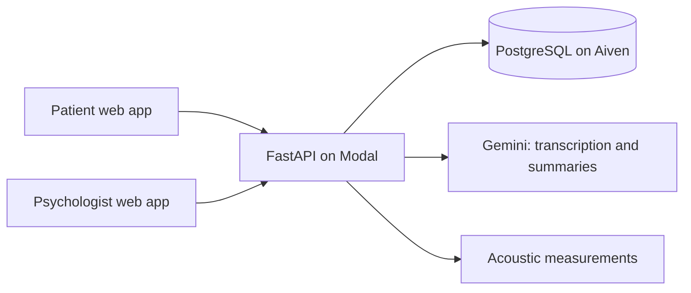

# numa

## The journal that grows with you.

Numa is a voice and text journal that helps people reflect on their days and notice what they find helpful. A personal garden grows with saved entries, while a separate psychologist portal shows limited observations without exposing the journal's words.

Built as an independent prototype for Junction 2026.

**[Try the live demo](https://numa-one-xi.vercel.app)** · **[Patient portal](https://numa-one-xi.vercel.app/login/patient)** · **[Psychologist portal](https://numa-one-xi.vercel.app/login/psychologist)** · **[Current project status](docs/PROJECT_STATUS.md)**

## Try it in two minutes

1. Open the patient portal and enter a **fictional, distinctive name**. Record a short voice note or write an entry, review the transcription, then press **Plant this entry**.
2. Explore **My journal** and **My garden**. Record activity feedback or choose an optional module under **Your space**. The [fictional sample journal](https://numa-one-xi.vercel.app/login/patient?sample=1) lets you explore a longer history.
3. Open the psychologist portal in a separate tab, enter a demo name, and find the patient name you used. The list refreshes automatically; only saved entries contribute to the count. Open the patient to see the limited clinical view.

The public demo uses names without passwords. The same normalized patient name reopens the same journal; anyone who knows that name can access it. Use fictional content only. Sample and psychologist names are greeting aliases. Existing shared entries from the earlier demo remain under **Alex Morgan**.

The [visual recording script](docs/DEMO.md) describes the planned short demo video. The video has not been recorded or published yet.

## What works today

| Area | Current behavior |
|---|---|
| Voice and text journal | Real microphone capture, replay before saving, a written alternative, editable review, save and delete. |
| Transcription and summaries | Gemini processes audio and journal text in the connected demo. |
| Persistent profiles | Aiven PostgreSQL stores separate named patient profiles, entries, preferences and feedback. |
| Personal garden | Saved entries, reported helpful activities, optional habits, patterns and private experiments. No mandatory mood score or streak penalty. |
| Psychologist portal | Assigned patients, saved-entry counts, acoustic observations, activity feedback, notes and a printable report. Transcripts, summaries and experiment reflections are excluded. |
| Acoustic measurements | Duration, energy and pause estimates are measured from audio. They are not emotional or diagnostic predictions. |
| Context cards | Sleep, steps, weather, outdoors and music are **simulated and labelled**. External account connections are placeholders. |
| Vocal ML | **Disabled in the public app.** DAM and Silero VAD have separate experimental tools and recorded technical checks; they are not integrated into the diary. |

The fictional sample's longitudinal history is seeded data, not evidence collected from a new demo entry. The prototype has no clinical validation and provides no diagnosis.

## How it is built



Both web portals use React, TypeScript and Vite, deployed on Vercel. The API checks entry ownership and clinician assignment before returning data. Journal text and clinical projections use separate endpoints.

Raw audio is held temporarily for processing and is not stored by Numa. Saved audio cannot be replayed after a reload; transcripts and summaries persist. External processors have their own retention policies. The public demo's open name access is not private account authentication.

See [architecture and data boundaries](docs/ARCHITECTURE.md) and [deployment instructions](docs/DEPLOYMENT.md).

## Run locally

Requirements: Git, Node.js **22.12+**, Python **3.11+**, and FFmpeg on PATH for browser audio decoding. No cloud credentials are needed for the local preview.

```sh
git clone https://github.com/jjpaz/numa.git
cd numa
npm ci
python -m venv .venv
```

On macOS/Linux, use `python3` if `python` is unavailable.

**Windows PowerShell — start the API:**

```powershell
Copy-Item .env.example .env
.\.venv\Scripts\python.exe -m pip install -r backend/requirements.txt
.\.venv\Scripts\python.exe -m uvicorn backend.app:create_app --factory --host 127.0.0.1 --port 8000
```

**macOS/Linux — start the API:**

```sh
cp .env.example .env
.venv/bin/python -m pip install -r backend/requirements.txt
.venv/bin/python -m uvicorn backend.app:create_app --factory --host 127.0.0.1 --port 8000
```

In a second terminal, from the cloned `numa` directory:

```sh
npm run dev
```

Open [localhost:5173](http://127.0.0.1:5173). Vite proxies API requests to port 8000. Microphone access requires localhost or HTTPS.

| Local preview account | Email | Password |
|---|---|---|
| Fresh patient | patient@numa.demo | journal-demo |
| Fictional sample | sample@numa.demo | sample-demo |
| Psychologist | psychologist@numa.demo | care-demo |

The local preview uses ephemeral memory: restarting resets its entries. Without Gemini, recordings still yield acoustic measurements, but automatic transcription is unavailable; type or edit the words to complete the flow. Written entries use a labelled text passthrough. To try name-based profiles locally, add `NUMA_DEMO_NAME_LOGIN=true` to `.env` and restart the API.

## Checks

```sh
npm run build
```

Run the backend and isolated ML contract tests with your virtual environment's Python:

```powershell
# Windows
.\.venv\Scripts\python.exe -m pytest backend/tests backend/ml/tests -q
```

```sh
# macOS/Linux
.venv/bin/python -m pytest backend/tests backend/ml/tests -q
```

[GitHub Actions](https://github.com/jjpaz/numa/actions/workflows/ci.yml) builds the frontend and runs the backend/ML contract tests on pushes to `main` and pull requests. It uses test fixtures and mocked providers, without production secrets. The workflow also installs the optional Modal SDK to cover import-boundary checks; it does not deploy services or download model weights. Real PostgreSQL and DAM tests remain opt-in.

The existing browser suite runs with `npm run test:e2e` on Windows with Microsoft Edge and FFmpeg installed. It starts isolated servers on ports **5174/8001**; its backend launch command currently uses PowerShell. Run it with local demo settings, not a production environment. Browser tests are separate from the GitHub Actions checks.

## Project guide

- [Current status and validation](docs/PROJECT_STATUS.md)
- [Architecture, privacy boundaries and limitations](docs/ARCHITECTURE.md)
- [Connected deployment and local maintenance](docs/DEPLOYMENT.md)
- [Visual demo script](docs/DEMO.md)
- [Implementation and historical verification log](docs/IMPLEMENTATION_LOG.md)
- [Isolated DAM](docs/ML_DAM.md), [Modal execution](docs/ML_DAM_MODAL.md) and [VAD experiment](docs/ML_VAD.md)
- [Design system](DESIGN.md) and [future work](NUMA_NEXT_STEPS.md)

## License

Numa's source code is available under the [MIT license](LICENSE). Third-party model code, weights and datasets retain their own licenses and attribution.
